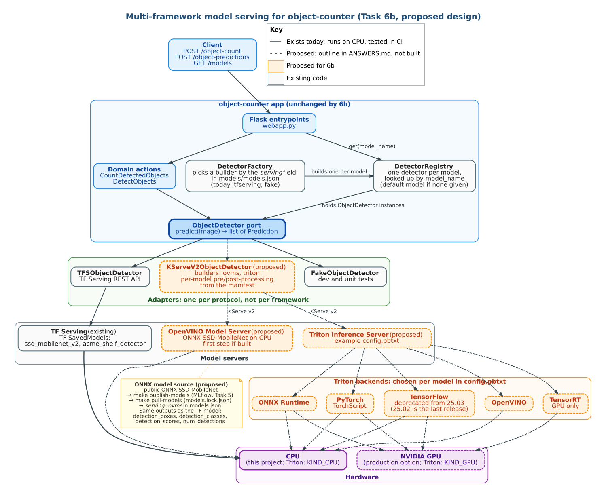

# Answers to the written tasks

This file answers the written parts of the assignment (`Task.md`):

- [Task 3: Code review and proposed improvements](#task-3-code-review-and-proposed-improvements) (with Task 4: which improvements are implemented)
- [Task 5: Multiple internally trained models](#task-5-multiple-internally-trained-models)
- [Task 6(a): Integration and end-to-end tests](#task-6a-integration-and-end-to-end-tests) (full strategy in [`TESTING.md`](TESTING.md))
- [Task 6(b): Multiple deep-learning frameworks (outline)](#task-6b-multiple-deep-learning-frameworks-outline) (design only, not built)

## Task 3: Code review and proposed improvements

> Review the rest of the source code and propose some improvements that you would make in the code, the setup instructions, the tests, ...

I reviewed the original code (commit `1095f74`, before any of my changes) and list each finding with the problem, its impact and the fix. Task 4 asks to implement at least one; the **Status** column links each implemented item to the pull request and files that implement it.

**Status:** ✅ implemented · 🟡 partly implemented · 📋 proposed (the ID in brackets is the plan item that will implement it; "not planned" means proposal only)

| Area | Findings | ✅ | 🟡 | 📋 |
|---|---|---|---|---|
| [API and validation](#31-api-and-validation) | 5 | 5 | 0 | 0 |
| [Architecture and domain code](#32-architecture-and-domain-code) | 6 | 5 | 0 | 1 |
| [Adapters](#33-adapters-tf-serving-and-mongodb) | 6 | 5 | 1 | 0 |
| [Setup and documentation](#34-setup-and-documentation) | 7 | 7 | 0 | 0 |
| [Tests](#35-tests) | 5 | 5 | 0 | 0 |
| [CI, security and dependencies](#36-ci-security-and-dependencies) | 4 | 4 | 0 | 0 |
| **Total** | **33** | **31** | **1** | **1** |

### 3.1 API and validation

| ID | Problem | Impact | Proposed fix | Status |
|---|---|---|---|---|
| R1 | `/object-count` converts the threshold with a bare `float(...)`. | `threshold=abc` returns a 500 HTML error page; a client error looks like a server crash. | Parse and validate in one function; return 400 problem+json naming the field. | ✅ [PR #11](https://github.com/gsarwarllm/object-counter-vibe-coding/pull/11): both endpoints use `parse_image_request` ([`schemas.py`](../counter/entrypoints/schemas.py)); first done for `/object-predictions` in PR #3 |
| R2 | The threshold range isn't checked. | `threshold=5` or `-1` is accepted and silently returns nothing or everything. | Reject values outside `[0, 1]` with 400. | ✅ [PR #11](https://github.com/gsarwarllm/object-counter-vibe-coding/pull/11); later moved from [`schemas.py`](../counter/entrypoints/schemas.py) into the core ([`actions.py`](../counter/domain/actions.py) `check_threshold`), so the CLI enforces it too: the range is a business rule, the web adapter only parses the number |
| R3 | A missing `file` field raises `KeyError` in `request.files["file"]`. | Flask returns an HTML 400 page, not JSON; API clients can't parse it. | Check for the field; return 400 problem+json. Register JSON error handlers for every status. | ✅ [PR #11](https://github.com/gsarwarllm/object-counter-vibe-coding/pull/11): problem+json for every status, including 404/405 and 500 ([`webapp.py`](../counter/entrypoints/webapp.py)) |
| R4 | Non-image uploads reach the detector. | Pillow raises inside the adapter → 500. | Decode once at the edge; return 400 "Invalid image". | ✅ [PR #11](https://github.com/gsarwarllm/object-counter-vibe-coding/pull/11): 400 "Invalid image" on both endpoints |
| R5 | No upload size limit. | A client can send arbitrarily large bodies; the image is read fully into memory. | Set `MAX_CONTENT_LENGTH` (10 MB) and return 413 problem+json. | ✅ [PR #11](https://github.com/gsarwarllm/object-counter-vibe-coding/pull/11): `MAX_UPLOAD_BYTES` (default 10 MB) → 413 problem+json |

### 3.2 Architecture and domain code

| ID | Problem | Impact | Proposed fix | Status |
|---|---|---|---|---|
| R6 | The domain layer imports Pillow and `counter.debug` and writes JPEGs (`actions._debug_image`) whenever Python runs without `-O`. | Breaks the hexagonal rule that the domain has no I/O; every request writes files into the working directory in dev, and fails if it's read-only. | Move debug drawing to an adapter injected into the actions (`debug_image_writer` or `None`), enabled by a `DEBUG_IMAGES` flag. | ✅ [PR #11](https://github.com/gsarwarllm/object-counter-vibe-coding/pull/11): `DebugImageWriter` port ([`ports.py`](../counter/domain/ports.py)) and [`FileDebugImageWriter`](../counter/adapters/debug_image_writer.py), enabled by `DEBUG_IMAGES=1`; the domain no longer imports Pillow |
| R7 | `config.py` picks factories by string with `globals()[f"{ENV}_..."]`. | An unknown `ENV` fails with a bare `KeyError`; the indirection hides which factories exist. | An explicit registry dict and a clear error message. | ✅ `COUNT_REPOS` registry ([PR #9](https://github.com/gsarwarllm/object-counter-vibe-coding/pull/9)) and `OBJECT_DETECTORS` registry with a clear error for an unknown `ENV` ([PR #11](https://github.com/gsarwarllm/object-counter-vibe-coding/pull/11), [`config.py`](../counter/config.py)) |
| R8 | `create_app()` reads `ENV` itself to build its dependencies. | `ENV=prod pytest` fails without live services; tests can't inject fakes. | Let `create_app(count_action=..., detect_action=...)` accept dependencies, defaulting to config. | ✅ [PR #11](https://github.com/gsarwarllm/object-counter-vibe-coding/pull/11): `create_app(count_action=..., detect_action=...)`; tests inject failing detectors |
| R9 | `count()` uses `functools.reduce` with a module-private helper. | Harder to read than needed. | `collections.Counter(p.class_name for p in predictions)`. | ✅ PR #17 ([`predictions.py`](../counter/domain/predictions.py)) |
| R10 | Type hints are missing on the public use-case methods (`execute(self, image, threshold)`), and nothing checks them. | Interface mistakes surface only at runtime. | Add hints (`BinaryIO`, `float`) and run `mypy` in CI. | ✅ [PR #19](https://github.com/gsarwarllm/object-counter-vibe-coding/pull/19): every function in `counter/` and `scripts/` annotated; `mypy` (strict on untyped defs, settings in [`pyproject.toml`](../pyproject.toml)) runs in the CI `lint` job and `make check` |
| R11 | `/object-count` updates the totals and then reads them in two separate calls. | Under concurrent requests, the `total_objects` returned can include other requests' counts. The stored totals are still correct. | Document it, or return the totals from the same transaction (Postgres `RETURNING`). | 📋 not planned (acceptable for running totals) |

### 3.3 Adapters (TF Serving and MongoDB)

| ID | Problem | Impact | Proposed fix | Status |
|---|---|---|---|---|
| R12 | `TFSObjectDetector` decodes images with `np.array(image.getdata()).reshape((h, w, 3))`. | RGBA PNGs and greyscale images crash with a reshape error (500); `getdata()` is also slow. | `Image.open(...).convert("RGB")` and `np.asarray(...)`; raise `InvalidImageError` for undecodable input. | ✅ [PR #11](https://github.com/gsarwarllm/object-counter-vibe-coding/pull/11): any mode converted to RGB; tests for RGB, RGBA, greyscale and palette images ([`test_object_detector.py`](../tests/adapters/test_object_detector.py)) |
| R13 | The TF Serving call had no timeout, no status check and used `print` for logging. | A hung model server blocks a worker forever; HTTP errors become confusing `KeyError`s; logs can't be filtered or shipped. | `timeout`, `raise_for_status()`, wrap failures in `DetectorUnavailableError` → 503, use `logging`. | ✅ Timeout in [PR #6](https://github.com/gsarwarllm/object-counter-vibe-coding/pull/6); `raise_for_status`, `DetectorUnavailableError` → 503 and `logging` in [PR #11](https://github.com/gsarwarllm/object-counter-vibe-coding/pull/11) ([`object_detector.py`](../counter/adapters/object_detector.py)); logging configured for every entrypoint incl. gunicorn, `LOG_LEVEL`, access log, per-call model and duration, startup summary in [PR #18](https://github.com/gsarwarllm/object-counter-vibe-coding/pull/18) ([`logging_config.py`](../counter/logging_config.py)) |
| R14 | `CountMongoDBRepo` creates a new `MongoClient` on every read and write. | A new connection pool per call: slow, and can exhaust connections under load. Mongo errors become 500s. | Create the client once; set `serverSelectionTimeoutMS`; wrap `PyMongoError` in `RepositoryUnavailableError` → 503. | ✅ [PR #11](https://github.com/gsarwarllm/object-counter-vibe-coding/pull/11): one client per repo, `MONGO_TIMEOUT`, `PyMongoError` → 503 ([`count_repo.py`](../counter/adapters/count_repo.py)) |
| R15 | Resource files are opened by CWD-relative paths (`counter/adapters/mscoco_label_map.json`, `counter/resources/arial.ttf`). | The app only works when started from the repo root. | Resolve paths from `Path(__file__).parent`. | ✅ [PR #11](https://github.com/gsarwarllm/object-counter-vibe-coding/pull/11): label map and font resolved from `__file__`; tested from another working directory |
| R16 | Repo adapters disagreed on edge cases: the in-memory repo returned `None` for unknown classes; the Mongo repo returned every class for an empty list. | Callers get different results depending on the configured store. | One contract test suite run against every adapter, and fix the differences. | ✅ [PR #9](https://github.com/gsarwarllm/object-counter-vibe-coding/pull/9): [`tests/adapters/test_count_repo_contract.py`](../tests/adapters/test_count_repo_contract.py), fixes in [`count_repo.py`](../counter/adapters/count_repo.py) |
| R17 | The REST request sends the image as a JSON array of pixel integers, and the label map is a single fixed file loaded in the constructor. | Requests are several MB of JSON per image; adding a second model with other labels needs code changes. | Use TF Serving's gRPC API or a base64 `b64` input signature; inject the label map per model (needed for Task 5). | 🟡 Per-model label maps: `TFSObjectDetector` gets its classes from the model manifest ([PR #13](https://github.com/gsarwarllm/object-counter-vibe-coding/pull/13), [`detector_factory.py`](../counter/adapters/detector_factory.py)). gRPC / `b64` input not done (needs a live TF Serving to measure) |

### 3.4 Setup and documentation

| ID | Problem | Impact | Proposed fix | Status |
|---|---|---|---|---|
| R18 | The README says "Python >= 3.10" and pins nothing; `numpy==1.26.4` doesn't install on Python 3.13+. | Setup fails on current Python versions. | Pin Python 3.12 (`.python-version`, `requires-python`) and create the venv with uv. | ✅ [PR #8](https://github.com/gsarwarllm/object-counter-vibe-coding/pull/8): [`pyproject.toml`](../pyproject.toml), [`.python-version`](../.python-version), `make setup` |
| R19 | Setup is about ten manual steps (model download, two `docker run`s, venv, `PYTHONPATH`). | Slow and error-prone to reproduce; the evaluation asks for automation. | `Makefile` targets, `docker-compose.yml` with health checks, a model download script, pytest `pythonpath` config. | ✅ PR #8: [`Makefile`](../Makefile), [`docker-compose.yml`](../docker-compose.yml), [`scripts/download_model.sh`](../scripts/download_model.sh) |
| R20 | `tmp/model/model_config.config` serves a model called `rfcn` that the setup never downloads. | Using the config file with TF Serving fails to load any model. | Point it at `ssd_mobilenet_v2`, and have compose use it. | ✅ PR #8: [`model_config.config`](../tmp/model/model_config.config) |
| R21 | Runtime and test/tool dependencies are mixed in one file. | The production image installs pytest. | `requirements.txt` (runtime) and `requirements-dev.txt` (tools). | ✅ [PR #6](https://github.com/gsarwarllm/object-counter-vibe-coding/pull/6) and PR #8 |
| R22 | Configuration via env vars is undocumented. | Users have to read the code to find `TFS_HOST`, `MONGO_DB`, ... | `.env.example` and a README table of every variable with its default. | ✅ PR #8 and PR #9: [`.env.example`](../.env.example), [`README.md`](../README.md#configuration) |
| R23 | Only direct dependencies are pinned. | Transitive packages can change between installs, so builds aren't fully reproducible. | Generate a lock file (`uv pip compile` → `requirements.lock`). | ✅ PR #17: `requirements.lock` + `requirements-dev.lock`, used by `make setup`, CI and the Docker image; `make lock` regenerates them and CI fails if they're stale |
| R24 | `.vscode/launch.json` hard-codes `ENV=prod`. | Debugging in VS Code fails unless TF Serving and Mongo are running. | Add a dev configuration and make it the first entry. | ✅ PR #17 ([`launch.json`](../.vscode/launch.json): "Flask (dev)" first, "Flask (prod)" second) |

### 3.5 Tests

| ID | Problem | Impact | Proposed fix | Status |
|---|---|---|---|---|
| R25 | `test_object_detection` only asserts the body `!= None`. | The test passes even if the response shape is wrong. | Assert the response body (`current_objects`, `total_objects`). | ✅ [PR #11](https://github.com/gsarwarllm/object-counter-vibe-coding/pull/11): `test_object_count` asserts the full body ([`test_webapp.py`](../tests/entrypoints/test_webapp.py)) |
| R26 | The webapp test sends a `model_name` field the app ignores. | Misleading: suggests model selection exists. | Remove it (or implement selection in Task 5). | ✅ [PR #11](https://github.com/gsarwarllm/object-counter-vibe-coding/pull/11): removed |
| R27 | No tests for adapters, persistence or concurrency. | Bugs like R16 went unnoticed. | Integration tests against real databases (testcontainers), including 20 concurrent updates. | ✅ [PR #9](https://github.com/gsarwarllm/object-counter-vibe-coding/pull/9): [`tests/adapters/`](../tests/adapters/), CI `integration` job |
| R28 | No failure-path tests (database down, invalid input). | Error handling can regress silently. | Tests for each error status. | ✅ Every error status is tested on both endpoints: 400, 413, 503 (detector and database), 404/405 and 500 ([PR #11](https://github.com/gsarwarllm/object-counter-vibe-coding/pull/11)); repo-down tests in PR #9 and [PR #11](https://github.com/gsarwarllm/object-counter-vibe-coding/pull/11) |
| R29 | No end-to-end test of the real stack. | The TF Serving integration (payload format, label mapping) is untested. | e2e tests against the compose stack (`make test-e2e`). | ✅ [#15](https://github.com/gsarwarllm/object-counter-vibe-coding/pull/15): e2e tests against the Compose stack with the real models in TF Serving, run in CI against MongoDB and PostgreSQL ([`tests/e2e/`](../tests/e2e/), [`TESTING.md`](TESTING.md)) |

### 3.6 CI, security and dependencies

| ID | Problem | Impact | Proposed fix | Status |
|---|---|---|---|---|
| R30 | No CI. | Nothing stops a broken change from reaching `main`. | GitHub Actions on every PR. | ✅ [PR #2](https://github.com/gsarwarllm/object-counter-vibe-coding/pull/2), extended in PRs #6, #8, #9: jobs `test`, `integration`, `lint`, `security`, `docker` ([`ci.yml`](../.github/workflows/ci.yml)) |
| R31 | No linter or formatter. | Inconsistent style; easy mistakes (unused imports, mutable defaults) go unnoticed. | ruff lint and format checks in CI. | ✅ [PR #6](https://github.com/gsarwarllm/object-counter-vibe-coding/pull/6): 53 findings fixed, config in [`pyproject.toml`](../pyproject.toml) |
| R32 | Pinned dependencies had 15 known vulnerabilities (Pillow 11.3.0, requests, pymongo, Flask, pytest). | Known security issues in image decoding and HTTP handling. | Upgrade, and run `pip-audit` in CI; Dependabot security updates on. | ✅ PR #6 |
| R33 | `webapp.py` ran with `debug=True` on `0.0.0.0`. | The Werkzeug debugger allows remote code execution to anyone who can reach the port. | Bind `127.0.0.1` with the debugger off by default (`HOST`, `FLASK_DEBUG`); serve with gunicorn in Docker; bandit in CI. | ✅ PR #6 ([`webapp.py`](../counter/entrypoints/webapp.py)) and PR #8 ([`Dockerfile`](../Dockerfile)) |

### Task 4: implemented improvements

Task 4 asks to implement at least one proposal. **31 of the 33 are implemented**: R1–R10, R12–R16, R18–R33, and **R17 partly** (per-model label maps, with Task 5). Most code fixes are in [PR #11](https://github.com/gsarwarllm/object-counter-vibe-coding/pull/11) (plan item M4); setup in PR #8, the PostgreSQL adapter and contract tests in PR #9, CI and security in PRs #2 and #6, and R9, R23, R24 in PR #17, R10 in PR #19.

The one not implemented (R11), and the open part of R17, are proposals only, or are covered by later plan items:

| ID | Why not (yet) |
|---|---|
| R11 | Acceptable for running totals; would need a different repo API |
| R17 (gRPC part) | gRPC is a performance change that needs a live TF Serving to measure |

## Task 5: Multiple internally trained models

> If we want to use multiple models trained internally (not public), what would you change in the setup of the project?

### Short answer

Treat models as **versioned, private artifacts in a model registry** instead of files downloaded from a public URL. Describe each model in a **manifest** (its own label map, serving type and registry alias). Serve several models side by side with **pinned versions**, and let clients choose one per request with a `model_name` field. In code, a **factory** builds one detector per manifest entry behind the existing `ObjectDetector` port and a **registry** holds them, so adding a model is a configuration change, not a code change.

I implemented this end to end ([PR #13](https://github.com/gsarwarllm/object-counter-vibe-coding/pull/13)), with a local [MLflow](https://mlflow.org/) registry standing in for a company one.

### What I implemented

| Piece | What it does | Files |
|---|---|---|
| Model manifest | Lists the models, the default, and each one's serving type, registry alias, label map and source | [`models/models.json`](../models/models.json), [`models/labels/`](../models/labels/), [`model_manifest.py`](../counter/adapters/model_manifest.py) |
| Registry workflow | `make models` = download → publish new versions to MLflow (identical weights are skipped by SHA-256) → pull each alias's version into TF Serving's `<name>/<version>/` layout and generate `model_config.config` and `models.lock.json`. `make promote-model` moves an alias; `make mlflow-ui` shows the registry. | [`scripts/model_registry.py`](../scripts/model_registry.py), [`Makefile`](../Makefile), [`requirements-models.txt`](../requirements-models.txt) |
| Detector factory | Builds the `ObjectDetector` for a manifest entry from its `serving` type (`tfserving`, `fake`), with its own label map and pinned version | [`detector_factory.py`](../counter/adapters/detector_factory.py) |
| Detector registry | One detector per model, built at startup; knows the default; in prod, refuses to start if a model has no pulled version | [`detector_registry.py`](../counter/adapters/detector_registry.py), [`config.py`](../counter/config.py) |
| API | Optional `model_name` on `/object-count` and `/object-predictions` (unknown → 400 listing the models); responses include `"model": {"name", "version"}`; `GET /models` lists the models | [`webapp.py`](../counter/entrypoints/webapp.py), [`schemas.py`](../counter/entrypoints/schemas.py) |
| Second model | `acme_shelf_detector`: public SSDLite MobileNet v2 weights published under an internal name, to show two models with separate versions | `models/models.json` |
| Tests and CI | Manifest, factory, registry, model selection and `GET /models`; the registry scripts against a throwaway MLflow registry in a new CI `models` job; `pip-audit` also checks MLflow | [`tests/adapters/test_models.py`](../tests/adapters/test_models.py), [`tests/scripts/test_model_registry.py`](../tests/scripts/test_model_registry.py), [`ci.yml`](../.github/workflows/ci.yml) |

```
models/models.json ─> download ─> tmp/downloads/<name>/          (stand-in for training output)
                      publish  ─> MLflow: <name> v1, v2, ... + alias "champion"
                      pull     ─> tmp/model/<name>/<version>/ + model_config.config + models.lock.json
                                   │                                  │
                         TF Serving (pinned versions)       app: DetectorRegistry (one detector per model)
                                   ▲                                  │
request ─(model_name)─> use case ──┴──── ObjectDetector <─────────────┘
```

### What changes in the setup

**1. Storage and access control.** Internal weights are intellectual property: they don't belong in git, in public Docker images or behind public URLs. They live in a private registry (MLflow Model Registry, or S3, GCS or Artifactory behind one) that only CI and the serving hosts can read, with credentials from a secrets manager or a cloud service account, never from the repo. Here the registry is local (`tmp/mlflow/`, git-ignored). Pointing `MLFLOW_TRACKING_URI` at a company MLflow server is the only change needed to use a real one.

**2. Per-model metadata.** Each model brings its own label map, input expectations and serving type. The original code hard-coded the COCO label map inside the TF Serving adapter (finding R17). Now the manifest declares it and the factory passes it in, so a model trained on, say, shelf products with its own classes works without code changes.

**3. Serving several models.** TF Serving loads every model listed in `model_config.config`. `pull` generates that file with `model_version_policy { specific { versions: N } }`, so each model serves exactly the pulled version, even if others are on disk. The app calls `/v1/models/<name>/versions/<N>:predict`, so the version that answers is the one recorded in the lock file.

**4. Choosing a model per request.** A `model_name` form field, validated against the registry. Leaving it out uses the manifest's default model, so existing clients see no change. `GET /models` tells clients what's available.

**5. Code structure.** The hexagonal design already had the right seam:

| Pattern | Role |
|---|---|
| Strategy | The `ObjectDetector` port: TF Serving, the fake detector, and later other frameworks are interchangeable |
| Factory | `DetectorFactory.create(spec, version)` picks the adapter from the manifest's `serving` type |
| Registry | `DetectorRegistry` holds one detector per model and resolves `model_name` |
| Composition root | `config.get_detector_registry()` wires manifest, lock file and factory together |

The domain didn't change: the use cases still take one `ObjectDetector`, and the web layer builds one pair of use cases per model. Supporting another framework (Task 6b) is one adapter class plus one factory entry.

**6. Versioning, promotion and rollback.** Publishing registers a new version but doesn't serve it. Releasing means moving the `champion` alias (`make promote-model MODEL=... VERSION=...`), then `make pull-models` and a restart. Rolling back is the same command with the previous version. In a team, this is where an approval or evaluation gate belongs, e.g. promote only if the new version beats the current one on a held-out data set.

**7. Traceability.** Every response says which model and version produced it. Each registered version is tagged with the SHA-256 of its weights and its source, and `models.lock.json` records what's deployed.

**8. Configuration.** Model settings moved from a single env var (`MODEL_NAME`) to the manifest plus `MODELS_MANIFEST`, `MODELS_LOCK` and `MLFLOW_TRACKING_URI`. A next step would be one validated settings object (e.g. `pydantic-settings`).

**9. CI and security.** CI tests the registry scripts against a throwaway registry and audits MLflow's dependencies. In production, CI would pull models with a read-only service account, images would go to a private container registry, and each model would carry licence and intended-use notes.

### Design decisions

- **A parameter, not an endpoint per model.** Endpoints describe *what* the API does (count objects, list predictions); the model is *how*. An endpoint per model would add routes with every release, force clients to change URLs to switch or roll back, and repeat validation and documentation. A new endpoint is right only when a model does a *different task* with a different response, e.g. reading price tags.
- **No automatic fallback model.** If a model is unavailable the API returns 503 instead of quietly answering with another model. The app persists running totals, and counts from a different model (different classes and accuracy) would corrupt them without anyone noticing. A missing model is caught at startup instead: without a pulled version, the app doesn't start.
- **MLflow stays out of the runtime.** It's a ~640 MB dependency used only by the `make *-models` targets, in its own venv and requirements file. The app image and `requirements.txt` don't change, and replacing MLflow with another registry only touches `scripts/model_registry.py`.
- **One shared count store.** All models add to the same totals, which keeps the repository port unchanged. If totals per model are needed, the count key becomes `(model, class)`: a repository change, not a domain or API redesign.

### What is simulated, and what isn't verified

- There are no real internal models here, so `acme_shelf_detector` is public SSDLite MobileNet v2 (COCO) published under an internal name. Its label map is a copy of COCO: the point is the mechanism, not the content.
- The download step stands in for "training output". After it, everything goes through the registry.
- Verified locally: download, publish (twice, idempotent), promote, pull, the generated TF Serving config and lock file, model selection and `GET /models` in dev, and the prod code path against a stub TF Serving.
- Not verified: real TF Serving serving both models, because Docker isn't available on the development machine.

### Try it

```bash
make setup-models && make models     # registry and pulled models
make mlflow-ui                       # http://127.0.0.1:5001
make up && make run-prod
curl http://localhost:5000/models
curl -F model_name=acme_shelf_detector -F file=@resources/images/cat.jpg http://localhost:5000/object-predictions
```

## Task 6(a): Integration and end-to-end tests

> Improve the testing by adding integration and e2e tests (or any other improvements you consider necessary).

The full strategy (the test levels and what each proves, test doubles, contract tests, determinism with ML models, coverage, and what isn't tested) is in [`TESTING.md`](TESTING.md). This section summarises it.

### Before and after

| | Original code | Now |
|---|---|---|
| Tests | 5 (4 domain unit tests, and 1 API test that only checked the body `!= None`) | **161**, at every level |
| Integration | none | real PostgreSQL and MongoDB via Testcontainers; the API against both; the app over HTTP against a stub TF Serving |
| End-to-end | none | the Docker Compose stack with **both real models in TF Serving**, in CI, against MongoDB and then PostgreSQL |
| API contract | none | every documented path and status code validated against `docs/openapi.yaml` |
| CI | none | `test` (with a 90% coverage gate), `integration`, `models`, `e2e`, `lint`, `security`, `docker` on every PR |

### What was added in this task ([#15](https://github.com/gsarwarllm/object-counter-vibe-coding/pull/15))

- **Integration, no Docker needed:** [`tests/integration/test_tf_serving_http.py`](../tests/integration/test_tf_serving_http.py) runs the app in prod mode against an in-process HTTP server replaying a recorded TF Serving response. It checks the URL with the pinned version, the uint8 RGB batch actually sent for RGB, RGBA, greyscale and palette images, the mapping of the response, and that HTTP errors, malformed bodies, timeouts and a down server all become 503.
- **Integration with real databases:** [`tests/integration/test_api_with_databases.py`](../tests/integration/test_api_with_databases.py) checks, through the HTTP API, that counts are stored in PostgreSQL and MongoDB, survive an app restart, that `/object-predictions` writes nothing, and that 20 concurrent requests lose no update.
- **End-to-end:** [`tests/e2e/test_e2e.py`](../tests/e2e/test_e2e.py) runs black-box HTTP tests against the running stack (app container, TF Serving with the models pulled from the MLflow registry, a real database). It checks the real detections (cat, person), that the two models differ, RGBA and greyscale on the real model, totals in the API and in the database, and validates every response against the OpenAPI spec. CI runs it with counts in MongoDB, then in PostgreSQL.
- **Coverage:** `make coverage`; about 98% of `counter/` from the fast suite, and CI fails below 90%.
- **Tooling:** markers `integration`, `models` and `e2e` keep the default `make test` under 10 seconds with no Docker; `make test-integration`, `make test-models` and `make e2e` run the rest. The `integration` and `e2e` CI jobs fail on any skipped test.

### A bug the new tests found

The API-level concurrency test failed in 3 of 5 runs: on a fresh PostgreSQL database, concurrent first requests ran `CREATE TABLE IF NOT EXISTS` at the same time and one failed with a unique-constraint violation on `pg_type`, so the client got a 500. Unit tests and the earlier repository tests couldn't see it, because their fixtures created the table before the concurrent part. The fix serialises schema creation with a transaction-level advisory lock (`pg_advisory_xact_lock`), which also works across gunicorn worker processes. A regression test reproduces the race (it failed in 4 of 5 runs without the fix).

### Why these levels

- **Unit and component tests** stay the bulk (fast, precise), possible because the hexagonal ports let every external system be replaced by a fake.
- **Integration tests use the real technologies**, not substitutes like SQLite, because the risky parts are exactly the SQL, the HTTP protocol and concurrency.
- **E2E tests are few and assert properties, not exact scores**: they prove the deployed image, Compose wiring, model loading and payload format work together, while exact model accuracy belongs to model evaluation.

## Task 6(b): Multiple deep-learning frameworks (outline)

> Support models for object detection using different deep learning frameworks. If the task seems too big, just lay out the main key points of the proposed solution.

Task 6 asks for one of (a) or (b). (a) is implemented above; this section is an **outline only** ([#16](https://github.com/gsarwarllm/object-counter-vibe-coding/pull/16)): nothing here is built. Implementing it would add a third serving container, a second model format in the registry scripts and a heavier CI job, for little extra evidence, because the seam it plugs into already exists and is tested (Task 5).

### Short answer

The application never needs to know which framework trained a model. It already talks only to the `ObjectDetector` port, and since Task 5 the `serving` field of each model in `models/models.json` decides which adapter is built. Supporting other frameworks means:

1. Serve the models with a **multi-framework model server**: NVIDIA Triton Inference Server for the full range (ONNX Runtime, PyTorch, TensorFlow, OpenVINO and TensorRT backends), or OpenVINO Model Server as a lighter CPU-only first step.
2. Add **one adapter per serving protocol, not per framework**: a `KServeV2ObjectDetector`, because both servers speak the KServe v2 inference protocol. Which framework runs a model is then server configuration, not application code.
3. Describe each model's **input and output conventions in the manifest**, so models from different frameworks map to the same `Prediction`.

The domain, the endpoints, the count repositories and the API contract don't change.

### Architecture: multi-framework serving (proposed design)



*Figure: How Task 6b would plug into the existing ports-and-adapters design. Solid lines exist today; dashed lines and orange boxes are proposed and not built. Source: [`docs/diagrams/m6b_architecture.dot`](diagrams/m6b_architecture.dot) (Graphviz).*

**What this shows:** The app's domain code only talks to the `ObjectDetector` port. `DetectorFactory` reads the `serving` field of each model in `models/models.json` and builds one detector per model. `DetectorRegistry` holds those detectors. At startup the web layer builds one `CountDetectedObjects` / `DetectObjects` pair per model from the registry, and each request to `/object-count` or `/object-predictions` picks the pair by `model_name` (the default model if none is given). All of this exists today (Task 5). The proposal adds one adapter per *protocol*, not per framework: a `KServeV2ObjectDetector` that speaks the KServe v2 protocol (a standard request format for model servers), so the same code would work with both OpenVINO Model Server and Triton. Which framework runs a model (ONNX Runtime, PyTorch, TensorFlow, OpenVINO or TensorRT) is then decided by the model server's config, not by the app.

**What exists and what is proposed:**
- **Exists today (solid lines):** TF Serving with two TensorFlow SavedModels (`ssd_mobilenet_v2`, `acme_shelf_detector`), running on CPU and tested end to end in CI (Task 6a).
- **Proposed (dashed lines):** the `KServeV2ObjectDetector` adapter with `ovms` and `triton` builders in `DetectorFactory`; OpenVINO Model Server as the first, lightweight CPU target; Triton Inference Server with an example `config.pbtxt` for the full multi-backend setup.
- **Proposed model flow:** a public ONNX SSD-MobileNet goes through the existing Task 5 registry flow (`make publish-models` into MLflow, `make pull-models` writing `models.lock.json`) and is listed in `models.json` with `serving: ovms`. Its outputs (`detection_boxes`, `detection_classes`, `detection_scores`, `num_detections`) use the same format as the TF models, so the existing post-processing logic carries over.
- **Version note:** Triton deprecated its TensorFlow backend from release 25.03 (25.02 is the last release with it; [release notes](https://docs.nvidia.com/deeplearning/triton-inference-server/release-notes/rel-25-03.html)). TensorFlow models would stay on TF Serving, be converted to ONNX, or need Triton pinned to 25.02. ONNX Runtime, PyTorch and OpenVINO run on CPU; TensorRT needs an NVIDIA GPU.

**Why this design:** Once the KServe v2 adapter exists, adding a model from a new framework becomes a deploy step (add a model folder, its server config and a manifest entry), not new application code. The domain, endpoints and count repositories do not change, which is the separation ports and adapters is meant to give.

### Key points of the solution

**1. Adapters per protocol.** `KServeV2ObjectDetector` would send `POST /v2/models/{name}[/versions/{v}]/infer` with the image as a `UINT8` tensor of shape `[1, height, width, 3]`, read the named output tensors, and return `list[Prediction]`. It reuses what `TFSObjectDetector` already does: decoding any image mode to RGB, the pinned model version from `models.lock.json`, and turning HTTP, connection and malformed-response errors into `DetectorUnavailableError` (503). `DetectorFactory` gets two builders, `ovms` and `triton`, with their own host, port and timeout settings; `ENV=dev` keeps forcing the `fake` detector.

**2. Per-model pre- and post-processing in the manifest.** Models from different frameworks disagree on details, so each manifest entry would describe them instead of the code assuming TensorFlow conventions:

| Setting | Why it differs between models | Example |
|---|---|---|
| Input tensor name, dtype and layout | TF exports take `uint8` NHWC; PyTorch models usually take `float32` NCHW, normalised | `"input": "image_tensor:0"` |
| Output tensor names | Each export names its outputs | `"boxes": "detection_boxes:0"` |
| Box order | TF: `[ymin, xmin, ymax, xmax]`; torchvision: `[xmin, ymin, xmax, ymax]` | `"box_order": "yxyx"` |
| Coordinates | Normalised `[0, 1]` or pixels (then divided by the image size) | `"box_scale": "normalized"` |
| Class ids | COCO ids with or without a background class at 0 | `"class_id_offset": 0` |
| Label map | Already per model since Task 5 | `"label_map": "labels/mscoco.json"` |

Defaults would match today's TF models, so existing entries wouldn't change. If a model needs more than this (for example non-maximum suppression outside the graph), that work belongs in the model server (a Triton ensemble or a Python backend step), not in the app.

**3. Model export and conversion.** Training teams hand over a format a server can run: TensorFlow as a SavedModel (TF Serving) or converted to ONNX with `tf2onnx`; PyTorch as TorchScript (Triton's PyTorch backend) or ONNX (`torch.onnx.export`); for NVIDIA GPUs, ONNX compiled to a TensorRT engine; for Intel CPUs, ONNX or OpenVINO IR. ONNX is the common exchange format, so most models can run on ONNX Runtime or OpenVINO without their training framework installed.

**4. Registry and deployment.** The Task 5 flow stays: models are published to the MLflow registry, promoted with an alias, and pulled into `tmp/model/<name>/<version>/`, which is already the folder layout Triton and OpenVINO Model Server expect. `make pull-models` would additionally write each server's config (`config.pbtxt` per model for Triton, `config.json` for OpenVINO Model Server) next to today's TF Serving `model_config.config`, and the manifest gets a `format` field (`saved_model`, `onnx`, `torchscript`). The serving container is a new Docker Compose service, one per server used.

**5. Testing.** Same levels as Task 6(a):
- unit tests for the request body and response mapping (box order, class-id offset, unknown ids, malformed responses);
- an HTTP integration test against a stub KServe v2 server with a recorded response, like `tests/integration/stub_tf_serving.py`, so it runs without Docker;
- one shared adapter contract test that every adapter must pass (boxes and scores in `[0, 1]`, known class names);
- e2e tests against the Compose stack with OpenVINO Model Server and the ONNX model on CPU (its image is small enough for CI). Full Triton (an image of 15-20 GB) and TensorRT (needs a GPU) would be tested on a GPU runner or a staging environment, not in the standard CI job.

### Trade-offs

| | TF Serving (today) | OpenVINO Model Server | Triton Inference Server |
|---|---|---|---|
| Frameworks | TensorFlow only | ONNX, OpenVINO IR, TensorFlow, PaddlePaddle | ONNX Runtime, PyTorch, TensorFlow (≤ 25.02), OpenVINO, TensorRT, Python |
| Hardware | CPU, NVIDIA GPU | Intel CPU and GPU | CPU (`KIND_CPU`), NVIDIA GPU (`KIND_GPU`) |
| Protocol | TF Serving REST | KServe v2 (and TF Serving API) | KServe v2 |
| Image size | small | small | very large (15-20 GB) |
| Extras | | | dynamic batching, ensembles, concurrent model execution, metrics |
| Fit | existing models | first step: CPU, fits CI | production with GPUs or many frameworks |

**Known trade-off:** KServe v2 JSON sends every pixel as a number, so one 640×480 image becomes several megabytes of JSON. The existing TF Serving adapter has the same cost, so it is acceptable here; in production the fix is KServe v2's binary data extension, which both OpenVINO Model Server and Triton support.

### If it were built

**The first step:** a small spike that starts OpenVINO Model Server with the ONNX model and sends one image, before writing any adapter code. The main open risk is whether OpenVINO's ONNX importer supports every operation in that converted model (it contains non-maximum suppression and loop operations). If it does not, the fallbacks are the opset-12 export of the model, or serving a different ONNX detector.

**Then, in order:** the `KServeV2ObjectDetector` adapter and manifest settings with unit and stub-server tests; `format` support and server configs in `scripts/model_registry.py`; the OpenVINO Model Server Compose service and an e2e test for the ONNX model in CI; Triton `config.pbtxt` examples and a non-default Compose profile. Rough effort: two to three days for the OpenVINO path including CI, plus one to two days for Triton on a machine that can run its image.
