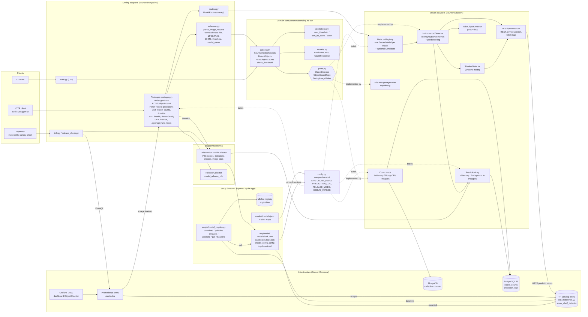

# System architecture

The whole system in one picture: clients, the hexagonal core, the adapters, the infrastructure the stack runs on, and the setup-time model pipeline. GitHub renders the Mermaid source below; elsewhere, paste it into [mermaid.live](https://mermaid.live).

## How to read it

- **Left to right:** clients, driving adapters, domain core, driven adapters, infrastructure.
- **The core owns the ports.** Adapters implement them (dotted "implemented by" edges); `counter/config.py`, the composition root, builds every concrete piece from environment variables.
- **Dev vs prod:** `ENV=dev` uses `FakeObjectDetector` and the in-memory count repo and prediction log, so no Docker is needed. `ENV=prod` uses TF Serving and MongoDB or PostgreSQL.
- **Setup time vs runtime:** the MLflow registry and `scripts/model_registry.py` run only at setup time. At runtime the app reads only the pulled files: pinned versions in `models.lock.json` and the drift baselines.

See [ARCHITECTURE.md](../ARCHITECTURE.md) for the layers in detail and [OPERATIONS.md](../OPERATIONS.md) for metrics, dashboards and drift.
