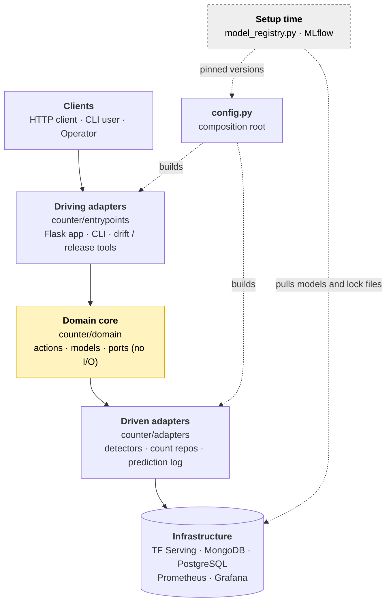
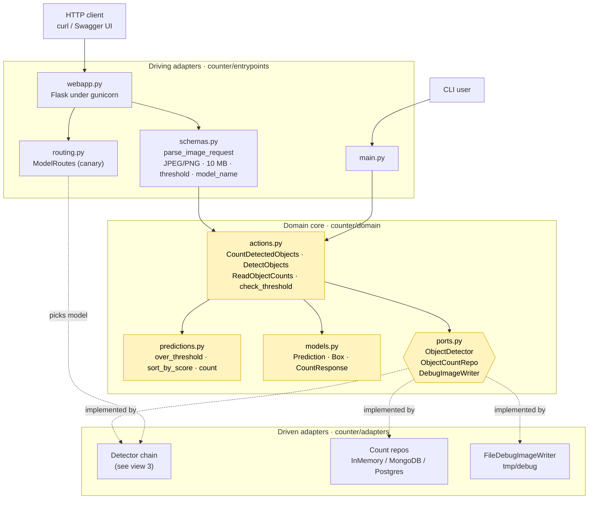
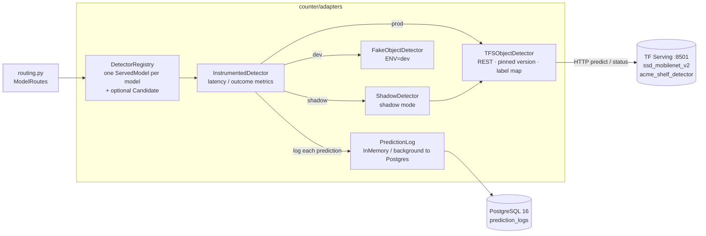
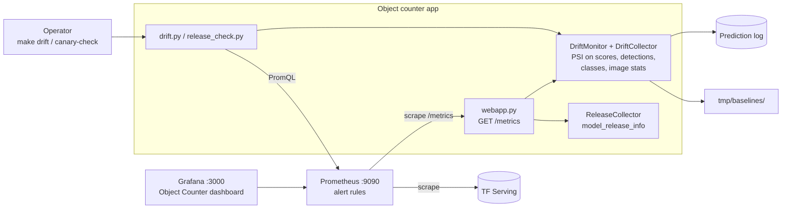
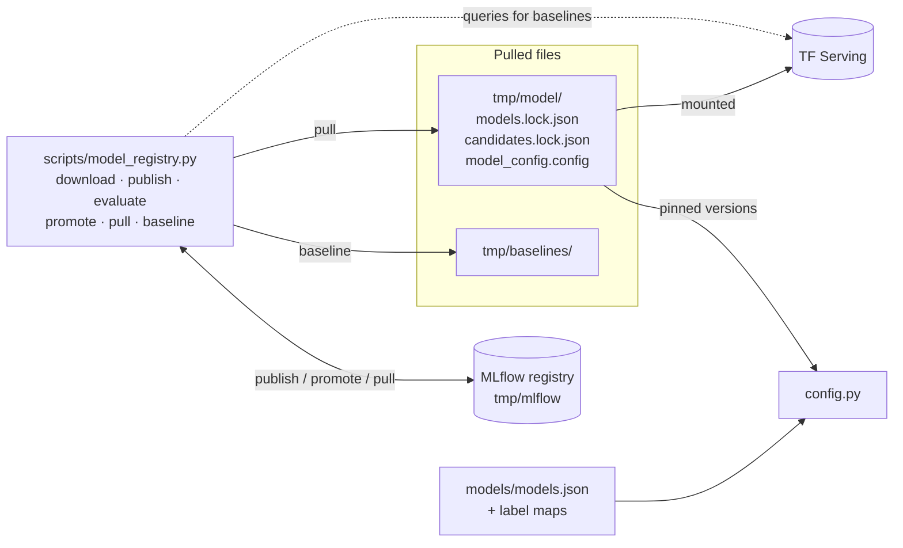

# System architecture

The system in five views, from the big picture down to the details. GitHub renders the Mermaid source below; elsewhere, paste it into [mermaid.live](https://mermaid.live).

1. [Overview](#1-overview): the layers and how they connect
2. [Request path](#2-request-path): an HTTP request through the hexagonal core
3. [Detection chain](#3-detection-chain): from the core's port to TF Serving
4. [Monitoring](#4-monitoring): metrics, drift and dashboards
5. [Setup-time model pipeline](#5-setup-time-model-pipeline): how models reach TF Serving

## 1. Overview

Each box is a layer; arrows show who calls whom. Dependencies point inward to the domain core, which has no I/O.

## 2. Request path

A `POST /object-count` request, top to bottom. The core defines the ports; the adapters implement them.

**Endpoints served by `webapp.py`:**

| Method | Path |
| --- | --- |
| POST | `/object-count`, `/object-predictions` |
| GET | `/object-counts`, `/models` |
| GET | `/health`, `/health/ready` |
| GET | `/metrics`, `/openapi.yaml`, `/docs` |

## 3. Detection chain

How an `ObjectDetector` call reaches a model, and what it writes on the way.

**Storage by environment:**

| | `ENV=dev` | `ENV=prod` |
| --- | --- | --- |
| Detector | `FakeObjectDetector` | `TFSObjectDetector` → TF Serving |
| Count repo | in memory | MongoDB (`counter`) or PostgreSQL (`object_counts`) |
| Prediction log | in memory | PostgreSQL (`prediction_logs`) |
| Docker needed | no | yes |

## 4. Monitoring

Prometheus scrapes the app and TF Serving; drift is computed from the prediction log against the setup-time baselines.

## 5. Setup-time model pipeline

Runs once before the stack starts; the app never imports this code. At runtime the app reads only the pulled files.

## How to read it

- **The core owns the ports.** Adapters implement them; `counter/config.py`, the composition root, builds every concrete piece from environment variables (`ENV`, `COUNT_REPO`, `PREDICTION_LOG`, `RELEASE_MODE`, `DEBUG_IMAGES`).
- **Dev vs prod:** `ENV=dev` uses `FakeObjectDetector` and the in-memory count repo and prediction log, so no Docker is needed. `ENV=prod` uses TF Serving and MongoDB or PostgreSQL.
- **Setup time vs runtime:** the MLflow registry and `scripts/model_registry.py` run only at setup time. At runtime the app reads only the pulled files: pinned versions in `models.lock.json` and the drift baselines.

See [ARCHITECTURE.md](../ARCHITECTURE.md) for the layers in detail and [OPERATIONS.md](../OPERATIONS.md) for metrics, dashboards and drift.
